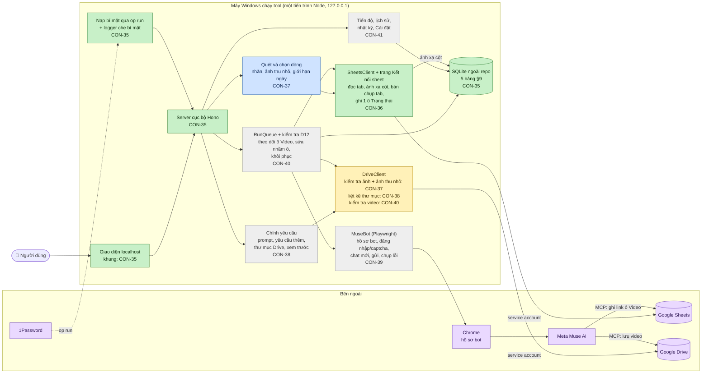

# Tiến độ dự án MASYS Video Generator

> Cập nhật lần cuối: **26/10/2026**, sau CON-36. File này được cập nhật trong PR của mỗi ticket CON.
> Muốn xem sơ đồ thành hình: bấm đúp **`TIEN-DO.html`** trong thư mục dự án (tạo lại bằng `npm run tien-do`).
> Đặc tả: [`SPEC-app-tao-video-ao.md`](SPEC-app-tao-video-ao.md) v4.1 · Linear: project **MASYS Video Generator**

**Tổng quan:** 2/8 ticket xong · 1 chờ duyệt · 5 chưa làm

```
[■■▣□□□□□]  2/8 xong — CON-37 chờ duyệt
```

## Sơ đồ kiến trúc theo trạng thái

Màu: 🟩 xong (đã merge) · 🟦 chờ duyệt (PR mở) · 🟨 đang làm · ⬜ chưa làm · 🟪 hệ thống bên ngoài



## Bảng ticket (Giai đoạn 1, spec §15)

| # | Ticket | Nội dung | Trạng thái | PR | Hoàn thành |
|---|---|---|---|---|---|
| 1 | [CON-35](https://linear.app/conducdaudan/issue/CON-35) | Khung dự án: Node + TS, server cục bộ + giao diện, SQLite, op run | 🟩 Xong | [#1](https://github.com/Bach1711/MASYS-VIDEO-GENERATOR/pull/1) | 26/10/2026 |
| 2 | [CON-36](https://linear.app/conducdaudan/issue/CON-36) | Google: service account, đọc tab, ánh xạ cột, ghi 1 ô Trạng thái | 🟩 Xong | [#2](https://github.com/Bach1711/MASYS-VIDEO-GENERATOR/pull/2) | 26/10/2026 |
| 3 | [CON-37](https://linear.app/conducdaudan/issue/CON-37) | Quét và chọn dòng, nhãn, ảnh thu nhỏ, giới hạn ngày | 🟦 Chờ duyệt | [#4](https://github.com/Bach1711/MASYS-VIDEO-GENERATOR/pull/4) | — |
| 4 | [CON-38](https://linear.app/conducdaudan/issue/CON-38) | Chỉnh yêu cầu, chọn thư mục Drive, xem trước | ⬜ Chưa làm | — | — |
| 5 | [CON-39](https://linear.app/conducdaudan/issue/CON-39) | MuseBot: hồ sơ bot, đăng nhập/captcha, chat mới, gửi, chụp lỗi | ⬜ Chưa làm | — | — |
| 6 | [CON-40](https://linear.app/conducdaudan/issue/CON-40) | Chạy lượt + kiểm tra D12, phát hiện sửa nhầm ô, khôi phục | ⬜ Chưa làm | — | — |
| 7 | [CON-41](https://linear.app/conducdaudan/issue/CON-41) | Tiến độ, lịch sử lô, nhật ký, Cài đặt | ⬜ Chưa làm | — | — |
| 8 | [CON-42](https://linear.app/conducdaudan/issue/CON-42) | Chạy đủ 12 tiêu chí với sheet thật, bàn giao | ⬜ Chưa làm | — | — |

## Nhật ký cập nhật

- **26/10/2026 · CON-37** (chờ duyệt): trang **Quét và chọn dòng**. Bảng mọi dòng có ảnh thu nhỏ (qua service account), prompt, trạng thái, nhãn *Sẵn sàng / Đã có video / Đang chạy / Thiếu dữ liệu* kèm lý do; Ghi đè từng dòng; Bỏ khoá có xác nhận; chọn bằng tích, khoảng `2-5, 8`, "Chọn mọi dòng chưa có video"; "Hôm nay: X/5 video" và khoá nút Chạy khi vượt. Nút Chạy hiện mới dẫn tới trang tóm tắt (gửi Muse làm từ CON-38). Đã thử với sheet thật: dòng 2–3 Sẵn sàng, ảnh thu nhỏ hiện đúng.

- **26/10/2026 · CON-36** (xong, đã duyệt và gộp vào main): trang **Kết nối sheet** (dán link → danh sách tab → tự đoán 4 cột → lưu theo sheet + tab); báo *"Chia sẻ sheet cho (email service account) với quyền chỉnh sửa"* khi thiếu quyền hoặc chỉ có quyền xem; đọc toàn tab và dòng N; ghi đúng 1 ô Trạng thái (`RAW`, Google phải xác nhận đúng ô); bản chụp tab + so sánh. Đã thử với sheet thật: ghi D2 → chỉ D2 đổi → trả lại như cũ.

- **26/10/2026 · CON-35** (xong, đã duyệt và gộp vào main): khung Node + TypeScript, Hono chỉ nghe `127.0.0.1:4310`, SQLite (better-sqlite3) ở `%LOCALAPPDATA%\masys-video\data.db` với 5 bảng §9, nạp khoá service account qua `op run` (thiếu khoá thì báo rõ, không crash), logger pino che key/token/cookie/khoá PEM.
