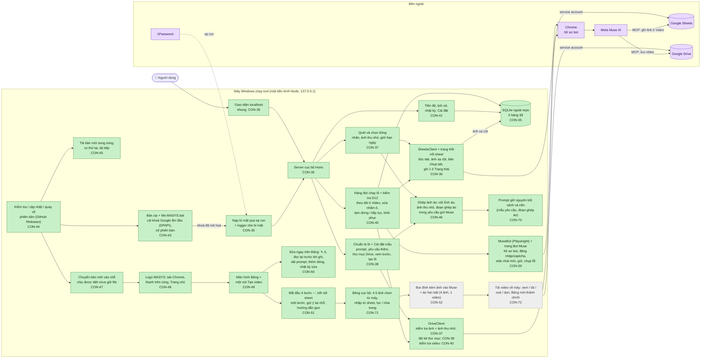

# Tiến độ dự án MASYS Video Generator

> Cập nhật lần cuối: **29/10/2026**, sau CON-71 — GĐ1–GĐ4 xong; GĐ5 "không Drive, không sheet" (spec v6.0 mục 17) theo góp ý 29/10: prompt giữ bối cảnh (CON-70), Bảng cục bộ + ảnh từ máy (CON-71), bot đính kèm ảnh + áo hai mặt (CON-52), tải video về (CON-72). File này được cập nhật trong PR của mỗi ticket CON.
> Muốn xem sơ đồ thành hình: bấm đúp **`TIEN-DO.html`** trong thư mục dự án (tạo lại bằng `npm run tien-do`).
> Đặc tả: [`SPEC-app-tao-video-ao.md`](SPEC-app-tao-video-ao.md) v6.0 · Linear: project **MASYS Video Generator**

**Tổng quan:** 19/21 ticket xong · GĐ1 8/8 🎉 · GĐ2 3/3 🎉 · GĐ3 3/3 🎉 · GĐ4 3/3 🎉 · GĐ5 2/4

```
[■■■■■■■■■□]  19/21 — xong CON-35…CON-51, CON-70, CON-71 · CON-52, CON-72 chưa làm
```

## Sơ đồ kiến trúc theo trạng thái

Màu: 🟩 xong (đã merge) · 🟦 chờ duyệt (PR mở) · 🟨 đang làm · ⬜ chưa làm · 🟪 hệ thống bên ngoài



## Bảng ticket (Giai đoạn 1, spec §15)

| # | Ticket | Nội dung | Trạng thái | PR | Hoàn thành |
|---|---|---|---|---|---|
| 1 | [CON-35](https://linear.app/conducdaudan/issue/CON-35) | Khung dự án: Node + TS, server cục bộ + giao diện, SQLite, op run | 🟩 Xong | [#1](https://github.com/Bach1711/MASYS-VIDEO-GENERATOR/pull/1) | 26/10/2026 |
| 2 | [CON-36](https://linear.app/conducdaudan/issue/CON-36) | Google: service account, đọc tab, ánh xạ cột, ghi 1 ô Trạng thái | 🟩 Xong | [#2](https://github.com/Bach1711/MASYS-VIDEO-GENERATOR/pull/2) | 26/10/2026 |
| 3 | [CON-37](https://linear.app/conducdaudan/issue/CON-37) | Quét và chọn dòng, nhãn, ảnh thu nhỏ, giới hạn ngày | 🟩 Xong | [#4](https://github.com/Bach1711/MASYS-VIDEO-GENERATOR/pull/4) | 26/10/2026 |
| 4 | [CON-38](https://linear.app/conducdaudan/issue/CON-38) | Chỉnh yêu cầu, chọn thư mục Drive, xem trước | 🟩 Xong | [#5](https://github.com/Bach1711/MASYS-VIDEO-GENERATOR/pull/5) | 26/10/2026 |
| 5 | [CON-39](https://linear.app/conducdaudan/issue/CON-39) | MuseBot: hồ sơ bot, đăng nhập/captcha, chat mới, gửi, chụp lỗi | 🟩 Xong | [#6](https://github.com/Bach1711/MASYS-VIDEO-GENERATOR/pull/6) | 26/10/2026 |
| 6 | [CON-40](https://linear.app/conducdaudan/issue/CON-40) | Chạy lượt + kiểm tra D12, phát hiện sửa nhầm ô, khôi phục | 🟩 Xong | [#7](https://github.com/Bach1711/MASYS-VIDEO-GENERATOR/pull/7) | 27/10/2026 |
| 7 | [CON-41](https://linear.app/conducdaudan/issue/CON-41) | Tiến độ, lịch sử lô, nhật ký, Cài đặt | 🟩 Xong | [#8](https://github.com/Bach1711/MASYS-VIDEO-GENERATOR/pull/8) | 27/10/2026 |
| 8 | [CON-42](https://linear.app/conducdaudan/issue/CON-42) | Chạy đủ 12 tiêu chí với sheet thật, bàn giao | 🟩 Xong | [#9](https://github.com/Bach1711/MASYS-VIDEO-GENERATOR/pull/9) | 27/10/2026 |

## Bảng ticket (Giai đoạn 2 — phát hành cho đội, spec §15)

| # | Ticket | Nội dung | Trạng thái | PR | Hoàn thành |
|---|---|---|---|---|---|
| 9 | [CON-43](https://linear.app/conducdaudan/issue/CON-43) | Đóng gói zip chạy ngay, cài khoá Google lần đầu, số phiên bản | 🟩 Xong | [#10](https://github.com/Bach1711/MASYS-VIDEO-GENERATOR/pull/10) | 27/10/2026 |
| 10 | [CON-44](https://linear.app/conducdaudan/issue/CON-44) | Kiểm tra và cập nhật phiên bản ngay trong tool | 🟩 Xong | [#11](https://github.com/Bach1711/MASYS-VIDEO-GENERATOR/pull/11) | 27/10/2026 |
| 11 | [CON-45](https://linear.app/conducdaudan/issue/CON-45) | Sửa lỗi: cập nhật tải chậm / đứng khi mạng chập chờn (v1.0.2) | 🟩 Xong | [#13](https://github.com/Bach1711/MASYS-VIDEO-GENERATOR/pull/13) | 28/10/2026 |

## Bảng ticket (Giai đoạn 3 — theo góp ý của đội, spec v4.4)

| # | Ticket | Nội dung | Trạng thái | PR | Hoàn thành |
|---|---|---|---|---|---|
| 12 | [CON-46](https://linear.app/conducdaudan/issue/CON-46) | Ghép ảnh áo vào ảnh người mẫu rồi tạo video (cột Ảnh áo, v1.1.0) | 🟩 Xong | [#14](https://github.com/Bach1711/MASYS-VIDEO-GENERATOR/pull/14) | 28/10/2026 |
| 13 | [CON-47](https://linear.app/conducdaudan/issue/CON-47) | Sửa lỗi: cập nhật báo EPERM khi diệt virus giữ file (v1.1.1) | 🟩 Xong | [#15](https://github.com/Bach1711/MASYS-VIDEO-GENERATOR/pull/15) | 28/10/2026 |
| 14 | [CON-48](https://linear.app/conducdaudan/issue/CON-48) | Thêm logo MASYS (tab Chrome, thanh trên cùng, Trang chủ), thử cập nhật từ v1.1.1 (v1.1.2) | 🟩 Xong | [#16](https://github.com/Bach1711/MASYS-VIDEO-GENERATOR/pull/16) | 28/10/2026 |

## Bảng ticket (Giai đoạn 4 — một màn hình, spec v5.0 mục 16)

| # | Ticket | Nội dung | Trạng thái | PR | Hoàn thành |
|---|---|---|---|---|---|
| 15 | [CON-49](https://linear.app/conducdaudan/issue/CON-49) | Màn hình Bảng + một nút Tạo video (v1.2.0) | 🟩 Xong | [#17](https://github.com/Bach1711/MASYS-VIDEO-GENERATOR/pull/17) | 28/10/2026 |
| 16 | [CON-50](https://linear.app/conducdaudan/issue/CON-50) | Sửa ngay trên Bảng: prompt, link ảnh, dải prompt, thêm dòng (v1.3.0) | 🟩 Xong | [#18](https://github.com/Bach1711/MASYS-VIDEO-GENERATOR/pull/18) | 28/10/2026 |
| 17 | [CON-51](https://linear.app/conducdaudan/issue/CON-51) | Bắt đầu nhanh và hướng dẫn gọn (v1.4.0) | 🟩 Xong | [#19](https://github.com/Bach1711/MASYS-VIDEO-GENERATOR/pull/19) | 28/10/2026 |

(CON-52 "Áo hai mặt" chuyển sang GĐ5 theo spec v6.0.)

## Bảng ticket (Giai đoạn 5 — không Drive, không sheet, spec v6.0 mục 17)

| # | Ticket | Nội dung | Trạng thái | PR | Hoàn thành |
|---|---|---|---|---|---|
| 18 | [CON-70](https://linear.app/conducdaudan/issue/CON-70) | Prompt giữ nguyên bối cảnh và nền (v1.4.1) | 🟩 Xong | [#20](https://github.com/Bach1711/MASYS-VIDEO-GENERATOR/pull/20) | 29/10/2026 |
| 19 | [CON-71](https://linear.app/conducdaudan/issue/CON-71) | Bảng cục bộ + ảnh chọn từ máy + nhập từ sheet (v1.5.0) | 🟩 Xong | [#21](https://github.com/Bach1711/MASYS-VIDEO-GENERATOR/pull/21) | 29/10/2026 |
| 20 | [CON-52](https://linear.app/conducdaudan/issue/CON-52) | Bot đính kèm ảnh vào Muse + áo hai mặt (v1.6.0) | ⬜ Chưa làm | | |
| 21 | [CON-72](https://linear.app/conducdaudan/issue/CON-72) | Tải video về máy, xem / tải / xoá / dọn; Bảng mới thành màn hình chính (v2.0.0) | ⬜ Chưa làm | | |

## Nhật ký cập nhật

- **29/10/2026 · CON-71** (xong, đã duyệt và gộp vào main): **dò bot (17.7) đạt**: Muse nhận nhiều ảnh đính kèm một lần; một lượt gửi thật (đã đồng ý, ảnh dòng 2 từ máy) ra video 720×1280, 10 giây ngay trong chat sau ≈4 phút, giữ nền; bot đọc được file MP4 từ trang. **v1.5.0**: **Bảng mới (đang thử)** ở ⚙ Nâng cao: 4 ô ảnh Mẫu trước / Áo trước / Mẫu sau / Áo sau chọn từ máy hoặc kéo thả (JPG, PNG, WEBP ≤ 20 MB, tool chép vào thư mục dữ liệu), thêm dòng (một dòng trống, hoặc nhiều ảnh → mỗi ảnh một dòng), sửa prompt, dải prompt, chọn mọi dòng sẵn sàng, nhãn Sẵn sàng / Thiếu dữ liệu, lọc Tất cả / Hôm nay / Chưa tạo / Thiếu dữ liệu / Đã có video, tìm, 50 dòng một trang, ảnh tải dần, dung lượng đang dùng; **Nhập từ Google Sheet** chỉ đọc (xem trước "Sẽ thêm N dòng", bỏ dòng đã có video / đã nhập). Giới hạn ngày mặc định 100, tối đa 150 (D25). Nút Tạo video của Bảng mới có ở v1.6.0. Thử 100 dòng giả + nhập thật 5 dòng từ sheet Muse; 230 test đạt.
- **29/10/2026 · CON-70** (xong, đã duyệt và gộp vào main): theo góp ý của đội ngày 29/10 (Google Doc "Tool tạo video", thẻ Take note), **spec v6.0** (mục 17, D21–D27): ảnh chọn từ máy và bot đính kèm vào Muse, video tải về máy và xem / tải / xoá trên Bảng, bỏ Google Sheet và Drive (chỉ giữ nút nhập từ sheet), áo hai mặt = 4 ảnh ghép trước–trước / sau–sau ra một video, giới hạn ngày mặc định 100; tạo CON-71, CON-72, sửa CON-52 theo v6.0. **v1.4.1** (D27): mẫu yêu cầu gửi Muse thêm *"Giữ nguyên nền, bối cảnh và ánh sáng của ảnh người mẫu…"* và *"Từ prompt dưới đây chỉ lấy động tác, biểu cảm và cách quay; bỏ qua mọi mô tả bối cảnh…"*; đoạn ghép áo đổi thành *"chỉ thay chiếc áo, giữ nguyên khuôn mặt, tóc, dáng, tư thế, nền, bối cảnh và ánh sáng…"*. Máy dùng mẫu gốc tự nhận câu mới, máy đã sửa mẫu giữ bản của mình. Test cập nhật + test mới cho D27.

- **28/10/2026 · CON-51** (xong, đã duyệt và gộp vào main): **bắt đầu nhanh và hướng dẫn gọn** (spec v5.0 mục 16.5). Chưa kết nối sheet thì trang chủ là **4 bước có dấu ✅** (khoá Google · dán link sheet · đăng nhập Muse · thư mục Drive lưu video; bước 4 thêm theo yêu cầu người phụ trách); đủ bước thì Bảng không hiện gì, thiếu bước nào Bảng chỉ nhắc bước đó; mở lại được ở **⚙ Nâng cao → Các bước bắt đầu**. **Kết nối sheet một bước** (`/ket-noi`): dán link → tool kiểm tra quyền sửa, tự chọn tab (tab chưa kết nối đoán đủ 4 cột), tự đoán cột kèm tên tiêu đề → **Xác nhận** → về Bảng; đoán thiếu cột mới đưa sang chọn cột; **+ Thêm sheet** dùng luồng này. **Đăng nhập Muse**: Mở cửa sổ Muse → tự đăng nhập → Kiểm tra; tool nhớ lần thấy Muse sẵn sàng (cột mới `settings.museReadyAt`, migration chỉ thêm; cũng ghi khi gửi Muse thành công, xoá khi Muse đòi đăng nhập lại), không tự mở Chrome khi mở tool. **Thư mục Drive gốc** dán ngay ở bước 4, báo khi chưa có thư mục con "Video". Gợi ý tại chỗ: nút Tạo video, ô Lưu video vào, "Hôm nay x/5 · còn N", ô tích dòng không chọn được. **Hướng dẫn** gọn trong tool (`/huong-dan`, có bảng xử lý khi tạm dừng) thay trang giới thiệu cũ; **README** còn ~1 trang, bản cũ chuyển thành `HUONG-DAN-CHI-TIET.md`; `HUONG-DAN.txt` trong zip theo 4 bước. Đã chạy luồng như máy sạch (SQLite trống) với sheet + Drive thật, không bot, không ghi sheet: chưa có khoá → Cài khoá; dán link → tự chọn `Trang tính1`, đoán đúng 5 cột → Xác nhận → Bảng; dán thư mục → nhận thư mục con "Video"; chụp màn hình sáng/tối.

- **28/10/2026 · CON-50** (xong, đã duyệt và gộp vào main): **sửa ngay trên Bảng** (spec v5.0 mục 16.3, D18). Nút **✎** (ô trống: **+**) ở prompt, ảnh người mẫu, ảnh áo → **Lưu lên sheet**. Trước khi ghi tool đọc lại ô: khác giá trị lúc bắt đầu sửa → không ghi, báo *"Ô này vừa được người khác sửa"* và hiện giá trị mới (bấm Lưu lần nữa để ghi đè có chủ ý); ô là công thức → không ghi. Link ảnh kiểm tra như F3 trước khi ghi. **+ Thêm dòng** ghi vào dòng trống đầu tiên sau dòng có dữ liệu cuối (ở bất kỳ cột nào), tab hết dòng thì thêm dòng trống vào cuối tab. **Dải prompt ▾**: áp cho các dòng (*3-6, 9*, sẵn các dòng đang tích) hoặc dải xuống tới dòng cuối; báo *"Sẽ thay prompt của N dòng"* để xác nhận; bỏ qua dòng đang tạo video / đã có video (trừ khi tích) / đã cùng prompt; dòng bị sửa giữa lúc xem trước và lúc ghi thì không ghi. Dòng đang trong lô khoá sửa (không có ✎). Ghi bằng một lệnh `values.batchUpdate` RAW, chỉ cột Prompt / Ảnh / Ảnh áo, Google phải xác nhận đúng từng ô; ô Video / Trạng thái bị chặn ngay trong `SheetsClient`. Mỗi ô ghi vào bảng SQLite mới `sheet_edits` (migration chỉ thêm) và hiện ở **Nhật ký → Ô đã sửa từ Bảng**. Bot khi so bản chụp tab bỏ qua ô tool vừa ghi theo yêu cầu người dùng (nếu ô còn đúng giá trị đó), nên sửa dòng khác trên Bảng lúc lô chạy không làm lô dừng nhầm vì "Muse sửa ô khác". CLAUDE.md cập nhật quy tắc ghi sheet theo D18. Đã thử với sheet thật trên tab thử **"Thử CON-50"** (người phụ trách cho phép tool tạo): thêm 2 dòng, sửa prompt, xung đột, link sai, dải prompt; tab `Trang tính1` không bị ghi; chụp màn hình sáng/tối.

- **28/10/2026 · CON-49** (xong, đã duyệt và gộp vào main): **màn hình Bảng** theo góp ý của đội ("giao diện nhiều nút, hướng dẫn dài"), spec **v5.0** (mục 16, D17–D20). Trang chủ là bảng đọc từ tab sheet (nhớ tab dùng lần trước): ảnh người mẫu + ảnh áo (bấm xem lớn), prompt, video ▶, nhãn trạng thái. Tích chọn / **Chọn mọi dòng chưa có video** (không vượt số còn lại hôm nay) → **Tạo video** tạo lô với mặc định (thư mục con "Video" trong thư mục gốc, mẫu trong Cài đặt, prompt trong sheet) và chạy luôn; mọi kiểm tra cũ giữ nguyên (quét lại, Ghi đè D10, giới hạn ngày D13, không chạy chồng lô). Trạng thái từng lượt hiện trên bảng; bảng tự làm mới (5 giây khi chạy, 30 giây khi rảnh; sheet đổi mà đang chọn dòng thì chỉ báo). Tạm dừng / Tiếp tục / Huỷ và báo "đăng nhập Muse rồi bấm Tiếp tục" ngay trên bảng. Xem yêu cầu gửi Muse từng dòng (tải khi bấm). Theo góp ý người phụ trách khi duyệt: ô **Lưu video vào** (thư mục con trong thư mục gốc hoặc dán link, nhớ lần trước bằng cookie) và **+ Thêm sheet** (Kết nối sheet, lưu xong quay về Bảng). Trang cũ vào **⚙ Nâng cao**. Sửa thêm: ảnh thu nhỏ tải trùng khi nhiều dòng chung một ảnh (đôi khi ô xám); dấu nháy trong CSS bị mã hoá nên phông Segoe UI không áp dụng. Đã thử **chỉ đọc** với sheet thật (20 dòng, có ảnh áo dòng 5), chụp màn hình sáng/tối.

- **28/10/2026 · CON-48** (xong, đã duyệt và gộp vào main): **logo MASYS** từ file người phụ trách gửi (PNG 1600×1600 nền trong suốt). Tab Chrome và thanh trên cùng dùng phần vòng tròn có nút play cắt từ logo (chữ quá nhỏ sẽ nhoè); Trang chủ có logo đầy đủ trên khung nền tối cố định (dòng "VIDEO GENERATOR" màu xanh đậm vẫn rõ ở chế độ tối). Ảnh thu nhỏ bằng `scripts/logo.mjs`, nằm sẵn trong code (`src/web/logoData.ts`, ~145 KB) nên bản zip không thêm file; đường dẫn ảnh kèm số phiên bản để Chrome lấy ảnh mới sau khi cập nhật. Bản này cũng dùng để thử cập nhật trong tool từ v1.1.1 (sau bản sửa EPERM).

- **28/10/2026 · CON-47** (xong, đã duyệt và gộp vào main): **sửa lỗi cập nhật** phát hiện trên máy thứ hai (v1.0.0 → v1.1.0: tải xong nhưng báo `EPERM: operation not permitted, rename …`). Nguyên nhân: phần mềm diệt virus quét file vừa giải nén và giữ file, nên Windows không cho đổi tên thư mục; code cũ chỉ thử một lần. Bản v1.1.1: bị giữ file thì chờ tăng dần rồi thử lại (tới ~20 giây), vẫn không được thì **sao chép** thư mục sang chỗ mới; dọn thư mục tạm / bản cũ không được thì để lần sau, không làm hỏng việc cập nhật; trang cập nhật báo đang chờ quét; lỗi bằng tiếng Việt. Đã tái hiện trên Windows (PowerShell giữ `node.exe`): đổi tên thẳng báo đúng EPERM; code mới chờ ~8 giây rồi chuyển được, giữ lâu hơn thì sao chép thành công.

- **28/10/2026 · CON-46** (xong, đã duyệt và gộp vào main): **ghép ảnh áo** theo góp ý của đội (spec v4.4). Người phụ trách đã thử tay trên Muse: Muse ghép áo vào ảnh người mẫu rồi tạo video theo prompt trong cùng một lượt. Tool: **Kết nối sheet** thêm cột tuỳ chọn **Ảnh áo** (tự nhận tiêu đề "Ảnh áo", không lẫn với cột "Ảnh"); **Quét** hiện 2 ảnh thu nhỏ, link ảnh áo hỏng → *Thiếu dữ liệu*, ô trống → chạy như cũ; yêu cầu gửi Muse của dòng có ảnh áo có thêm **đoạn ghép áo** (phỏng theo câu người phụ trách đã thử) ngay dưới ảnh người mẫu, dòng không có thì không có; **Cài đặt** có khung **Đoạn ghép áo**; mẫu đã sửa tay mà thiếu chỗ `{doan_ghep_ao}` thì Cài đặt và Xem trước cảnh báo; trước khi gửi, ảnh áo đổi so với lúc tạo lô → *Cần xem*. Migration chỉ thêm cột. Đã thử chỉ đọc với sheet thật: tool nhận đúng cột E "Ảnh áo", đọc được ảnh áo dòng 5, xem trước đúng. Góp ý ~100 video/ngày: người phụ trách chốt để sau (đặt 50 trong Cài đặt là đủ).

- **28/10/2026 · CON-45** (xong, đã duyệt và gộp vào main): **sửa lỗi cập nhật trong tool** phát hiện khi thử trên máy thứ hai (tải đứng ở 4.5/50 MB, 16 phút sau báo lỗi tiếng Anh). Nguyên nhân: GitHub giới hạn tốc độ **theo từng kết nối** (đo được khoảng 33 KB/giây mỗi kết nối), còn tool cũ tải một kết nối, không phát hiện kết nối đứng, không thử lại. Bản v1.0.2: tải **8 phần cùng lúc** rồi ghép (đo thật với GitHub: 6 kết nối ≈ 175 KB/giây, nhanh gấp khoảng 5 lần); 30 giây không nhận thêm dữ liệu thì tự ngắt và thử lại, **tải tiếp từ chỗ dừng**; vẫn hỏng thì giữ phần đã tải, bấm Cập nhật lần nữa để tải tiếp; trang cập nhật hiện tốc độ và *"Mạng chập chờn, đang thử lại (lần N/5)"*; mọi lỗi bằng tiếng Việt. Test với máy chủ giả đứng / ngắt / không hỗ trợ tải từng đoạn.

- **27/10/2026 · CON-44** (xong, đã duyệt và gộp vào main): **cập nhật ngay trong tool** (spec D16). Trang **Cài đặt** có khung **Phiên bản**: bản đang dùng, nút *Kiểm tra phiên bản*, bản mới kèm ghi chú thay đổi, nút **Cập nhật lên vX.Y.Z** và **Quay về vX.Y.Z**. Mỗi lần mở tool tự hỏi GitHub một lần; có bản mới thì hiện dải báo trên đầu trang, không tự cập nhật. Cập nhật: tải → so SHA-256 → giải nén vào `phien-banX.Y.Z` cạnh bản cũ → sao lưu `data.db` (giữ 3) → khởi động lại → báo *Đã cập nhật*. Nút bị khoá khi lô đang chạy hoặc có dòng đang gửi / chờ Muse. Bản mới không lên trong 60 giây (hoặc hỏng ngay khi chạy) thì tự quay về bản cũ và báo. Chỉ tải từ GitHub Releases của repo này. Lệnh `npm run release` + `CHANGELOG.md` để phát hành. Đã chạy thử trên máy với GitHub giả: v1.0.0 → cập nhật v1.0.1 (5 giây, cài đặt còn nguyên) → Quay về v1.0.0 → cập nhật lên bản hỏng v1.0.2 → tự quay về v1.0.0; cả trường hợp launcher bản mới hỏng. Thử thật với GitHub sau khi gộp và công khai repo.

- **27/10/2026 · CON-43** (xong, đã duyệt và gộp vào main): **bản zip cho người trong đội** (spec D15). Lệnh `npm run package` tạo `MASYS-Video-v1.0.0-win64.zip` (50 MB): Node chạy liền + tool đã dựng + `Mo-MASYS.bat` + `HUONG-DAN.txt`. Bấm đúp `Mo-MASYS.bat` thì tool bật và tự mở trình duyệt; bấm lần nữa khi đang chạy thì chỉ mở trang; cổng bị chiếm thì báo rõ. **Lần đầu mở**, mọi trang dẫn về **Cài khoá Google**: chọn file khoá `.json` → tool kiểm tra với Google → mã hoá DPAPI theo tài khoản Windows, lưu ở `%LOCALAPPDATA%masys-video` → tự khởi động lại. Cài đặt có **Đổi file khoá** (khoá khi lô đang chạy) và số phiên bản; số phiên bản hiện ở cuối mọi trang. Trang Bot Muse báo khi máy chưa cài Chrome. `check-secrets` quét được cả trong zip và báo file cấm. Đã chạy thử bản zip trên máy này với PATH không có Node: cài khoá thật, khởi động lại, đọc sheet thật, mở Chrome bot — đều được. Người phụ trách đã thử trên máy thứ hai: giải nén, bấm đúp, cài khoá, tool chạy được. Ghi nhận: ô chọn file khoá chỉ hiện file .json (file .txt phải chọn "All Files" hoặc đổi đuôi).

- **27/10/2026 · CON-42** (xong, đã duyệt và gộp vào main): **nghiệm thu với sheet, Drive và Muse thật: đạt cả 12 tiêu chí §12** (bảng kết quả ở spec §12.1). Sheet thử 20 dòng; lô #3 (dòng 4, 6, 9, 10, 11) thử cùng lúc §12.2/3/4/5/8/9, lô #4 thử quá thời gian §12.7; §12.6 và §12.10 đã đạt sáng nay ở CON-40; §12.11 `check-secrets` sạch; §12.12 giới hạn ngày chặn đúng. Hôm nay 7 video thật, mỗi dòng gửi Muse đúng một lần; cài đặt đã trả về 20 phút / 5 video. **README viết lại thành tài liệu bàn giao** (cài máy mới, service account, đăng nhập bot, xử lý tạm dừng, sửa selector). Phát hiện: sửa tay sheet trong lúc lô chạy bị coi là "Muse sửa ô khác" — đã ghi hướng dẫn, chờ người phụ trách quyết có nới quy tắc không.
- **27/10/2026 · CON-41** (xong, đã duyệt và gộp vào main): **theo dõi và cài đặt**. Trang lô có thêm nút **Huỷ lô** (dòng đang chờ Muse vẫn được theo dõi cho xong, các dòng chưa gửi thành *Đã huỷ*). Câu báo tạm dừng đúng chữ spec (*Cần đăng nhập lại Muse*, *Giao diện Muse thay đổi*, *Muse hết lượt*, *Đã đủ video trong ngày*, *Muse sửa nhầm ô*) và **dải báo trên đầu mọi trang** khi có lô đang chạy / tạm dừng. Trang mới **Lịch sử lô** (thời gian, sheet, số dòng, đếm Xong / Lỗi / Cần xem / Bỏ qua / Đã huỷ) và **Nhật ký** (mặc định chỉ lỗi, có link ảnh chụp màn hình, lọc theo lô). Trang **Cài đặt** đủ mục F7: thời gian chờ, khoảng nghỉ, giới hạn video/ngày (nhắc rủi ro khi > 5), địa chỉ trang Muse, nút Mở trình duyệt bot. Lệnh mới `npm run check-secrets` (§12.11): quét repo, SQLite và log, đã chạy trên máy thật, sạch.
- **27/10/2026 · CON-40** (xong, đã duyệt và gộp vào main): **chạy cả lô tự động**. Trang **Lô #N** có nút *Bắt đầu chạy* / *Tạm dừng* / *Tiếp tục*, bảng trạng thái từng dòng tự cập nhật (gửi lúc, xong lúc, link video, link cuộc trò chuyện Muse). Mỗi dòng đi đủ 8 bước F5: đọc lại dòng (đã có link → bỏ qua; lệch dòng → Cần xem + tạm dừng), chụp toàn tab, ghi *Đang chạy*, gửi Muse trong side chat mới, theo dõi ô Video mỗi 20 giây (tối đa 20 phút → *Cần xem: quá thời gian*, không gửi lại), kiểm tra link (file Drive, là video, đúng thư mục) và so tab (Muse sửa ô khác → *Cần xem* + tạm dừng), ghi *Xong*; nghỉ 20–60 giây giữa hai dòng. Tự tạm dừng khi cần đăng nhập lại Muse, giao diện Muse đổi, Muse hết lượt, đủ 5 video/ngày; Muse chờ duyệt → báo trên trang lô, bot không tự bấm. Tool tắt giữa chừng → mở lại không gửi lại, theo dõi nốt dòng dở. **Đã chạy thật với Muse** (lô #2): tắt tool giữa lượt (§12.10) và đăng xuất Muse giữa lô (§12.6) đều đúng; 2 video, mỗi dòng gửi đúng một lần.

- **26/10/2026 · CON-39** (xong, đã duyệt và gộp vào main): **bot Muse**. Chrome riêng của bot (hồ sơ nằm ngoài repo, có cửa sổ) do Playwright điều khiển; trang **Bot Muse** có nút *Mở trình duyệt bot* (người dùng tự đăng nhập, bot không gõ mật khẩu, không vượt captcha), *Kiểm tra trạng thái* (Sẵn sàng / Cần đăng nhập / Kiểm tra bảo mật / Giao diện đổi kèm ảnh chụp), *Gửi thử cho Muse* một dòng Chờ chạy. Bot mở **side chat mới** (Chats → New side chat), dán yêu cầu, nghỉ vài giây, bấm Send, lưu link cuộc trò chuyện; lỗi sau khi đã bấm Gửi thì chuyển *Cần xem*, không gửi lại (D9). Mọi chỗ bot nhìn trên trang Muse gom vào `museSelectors.ts` theo tên thật ghi nhận trên muse.ai. **Lần gửi thật đầu tiên thành công:** khoảng 4 phút sau Muse lưu video `Trang tính1_row2_….mp4` (1080×1920, 8 giây) vào thư mục Video và dán link vào ô C2. Ghi nhận: Muse xin duyệt trước khi lưu Drive / sửa Sheet (người dùng chọn Always allow); để CON-40 xử lý.
- **26/10/2026 · CON-38** (xong, đã duyệt và gộp vào main): nút **Chạy** ở trang quét giờ mở trang **Chuẩn bị lô**. Mỗi dòng có ô Prompt (điền sẵn từ sheet, sửa được) và ô *Yêu cầu thêm riêng*; có ô *Yêu cầu thêm chung cho cả lô*; chọn thư mục Drive lưu video từ các thư mục con của **MASYS Video** (chọn sẵn **Video**) hoặc dán link thư mục khác (tool kiểm tra thư mục có thật, không nằm trong thùng rác). **Xem trước** hiện nguyên văn yêu cầu gửi Muse theo mẫu §8.2 → **Tạo lô** lưu lô và các dòng (trạng thái *Chờ chạy*) vào máy; **chưa gửi Muse** (CON-39/40). Phần sửa không ghi ngược vào sheet (§12.4). Không tạo lô nếu sheet đổi sau khi xem trước, dòng đã nằm trong lô chưa xong, hoặc vượt giới hạn ngày. Thêm trang **Cài đặt** rút gọn: thư mục Drive gốc và **mẫu yêu cầu** (lưu / khôi phục mẫu gốc / báo chỗ trống gõ sai). Đã thử với sheet + Drive thật (DB tạm): ghép đúng link ảnh, thư mục Video, ô C2, link sheet; sheet không đổi ô nào.
- **26/10/2026 · CON-37** (xong, người phụ trách đã bấm thử, duyệt và gộp vào main): trang **Quét và chọn dòng**. Bảng mọi dòng có ảnh thu nhỏ (qua service account), prompt, trạng thái, nhãn *Sẵn sàng / Đã có video / Đang chạy / Thiếu dữ liệu* kèm lý do; Ghi đè từng dòng; Bỏ khoá có xác nhận; chọn bằng tích, khoảng `2-5, 8`, "Chọn mọi dòng chưa có video"; "Hôm nay: X/5 video" và khoá nút Chạy khi vượt. Nút Chạy hiện mới dẫn tới trang tóm tắt (gửi Muse làm từ CON-38). Sau khi người phụ trách bấm thử: danh sách quét gom theo **tên file → trang tính** thay cho mã file. Đã thử với sheet thật: dòng 2–3 Sẵn sàng, ảnh thu nhỏ hiện đúng.

- **26/10/2026 · CON-36** (xong, đã duyệt và gộp vào main): trang **Kết nối sheet** (dán link → danh sách tab → tự đoán 4 cột → lưu theo sheet + tab); báo *"Chia sẻ sheet cho (email service account) với quyền chỉnh sửa"* khi thiếu quyền hoặc chỉ có quyền xem; đọc toàn tab và dòng N; ghi đúng 1 ô Trạng thái (`RAW`, Google phải xác nhận đúng ô); bản chụp tab + so sánh. Đã thử với sheet thật: ghi D2 → chỉ D2 đổi → trả lại như cũ.

- **26/10/2026 · CON-35** (xong, đã duyệt và gộp vào main): khung Node + TypeScript, Hono chỉ nghe `127.0.0.1:4310`, SQLite (better-sqlite3) ở `%LOCALAPPDATA%\masys-video\data.db` với 5 bảng §9, nạp khoá service account qua `op run` (thiếu khoá thì báo rõ, không crash), logger pino che key/token/cookie/khoá PEM.
